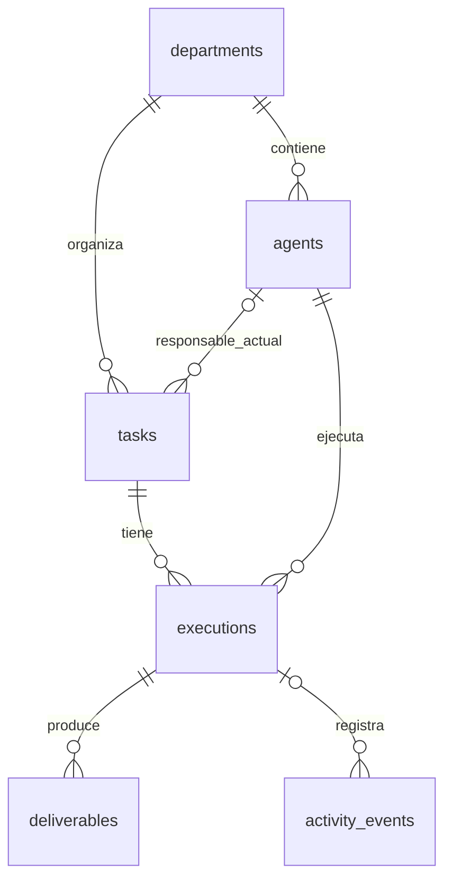

# DAK-011 · Departamentos, agentes, tareas y entregables

- **Fecha** — 21 de noviembre de 2026.
- **Estado** — Modelo implementado y verificado en PostgreSQL local aislado. Aplicado a Supabase de desarrollo y tablas verificadas mediante lectura autenticada.
- **Migración** — supabase/migrations/202611210001_office_model.sql.
- **Prueba** — supabase/tests/office_model.sql.

## Entidades

| Tabla | Responsabilidad |
|---|---|
| departments | Área de trabajo con nombre, descripción y fecha de archivo |
| agents | Rol, instrucciones, configuración y habilitación dentro de un departamento |
| tasks | Trabajo solicitado, responsable actual y estado |
| executions | Intento concreto, agente ejecutor, configuración capturada y resultado |
| deliverables | Versiones de entregables vinculadas a una ejecución y tarea |
| office_history | Registro automático de inserciones y actualizaciones con estado anterior y posterior |

## Responsabilidad e historial

Una tarea puede estar sin asignar. El responsable asignado pertenece al mismo departamento que la tarea, validado mediante clave foránea compuesta.

Al iniciar una ejecución, la base bloquea la fila de tarea y verifica el agente asignado. Captura el estado completo de la tarea y del agente, incluidas sus instrucciones. Esas capturas permanecen inmutables.

La reasignación posterior cambia la responsabilidad de la tarea. La ejecución conserva su agente original y su contexto. El registro office_history permite consultar todas las asignaciones anteriores, cambios de instrucciones y estados.

database_role identifica el rol técnico de base de datos. La atribución a una persona autenticada se incorporará con la autorización de usuarios. La configuración del agente guardará referencias a herramientas y secretos; los valores secretos pertenecen al entorno servidor.

## Estados

| Entidad | Estados |
|---|---|
| Tarea | pending, running, waiting, completed, failed, cancelled |
| Ejecución | running, waiting, succeeded, failed, cancelled |

La tarea representa el objetivo completo y puede acumular intentos. La ejecución representa un intento particular. El futuro orquestador actualizará ambas en una transacción cuando corresponda.

Cada ejecución nueva comienza en running, exige un agente habilitado y una tarea que permita iniciar trabajo. Una tarea completed o cancelled impide nuevos intentos.

Solo una ejecución por tarea puede estar running o waiting. La restricción única protege también frente a inserciones concurrentes. Al terminar, la base asigna finished_at y conserva el resultado. Los reintentos crean otra ejecución.

## Reintentos e idempotencia

request_key es un UUID único que el llamador conserva para reintentar la misma solicitud. Una repetición produce conflicto de unicidad; el llamador debe consultar la ejecución por esa clave y recuperar su resultado.

Un nuevo intento deliberado utiliza otro request_key después de finalizar el intento anterior. La cola y el tratamiento HTTP del conflicto se implementarán en las tareas de orquestación.

## Entregables

Cada entregable conserva tarea, ejecución, nombre, revisión positiva y contenido JSON. La clave foránea compuesta verifica que la ejecución pertenece a esa tarea.

Las revisiones se identifican por tarea, nombre y número. El llamador asigna la revisión y trata conflictos concurrentes mediante reintento. El rol backend puede insertar y leer entregables; una corrección se guarda como nueva revisión.

El contenido puede almacenar texto estructurado o una referencia a un archivo. El acceso y ciclo de vida de archivos se definirán al incorporar almacenamiento.

## Permisos y conservación

RLS está habilitado. anon y authenticated carecen de permisos sobre las nuevas tablas hasta definir las políticas de usuario. service_role puede realizar las operaciones necesarias mediante el backend.

Los permisos de actualización del backend se limitan a columnas editables. Los IDs, fechas originales y pertenencia al departamento permanecen fijos. El backend puede archivar departamentos y deshabilitar agentes. Las tablas nuevas conservan sus filas e historial.

office_history se escribe automáticamente dentro de la misma transacción que el cambio mediante una función de trigger con permisos elevados y search_path fijo. El backend puede leer ese historial. La administración de base de datos conserva sus facultades de mantenimiento.

## Compatibilidad

activity_events recibe execution_id opcional. Los eventos históricos y el monitor actual siguen siendo válidos con ese campo vacío. Los futuros agentes podrán enlazar su actividad a una ejecución.

La migración añade el esquema sin crear tareas, agentes ni resultados de ejemplo. El alta inicial del departamento y sus agentes se realizará al incorporar sus configuraciones operativas.

## Verificación

Se ejecutaron ambas migraciones sobre PostgreSQL 15 temporal, con roles anon, authenticated y service_role creados para la prueba.

La prueba comprueba asignación histórica, captura de instrucciones, unicidad de ejecuciones activas, vínculo tarea-entregable, permisos de conservación, cierre de ejecución y nuevo intento.

Los fixtures se revierten mediante rollback. La prueba requiere una base desechable con las migraciones aplicadas.

## Aplicación por entorno

El propietario aplicó la migración en SQL Editor del Supabase de desarrollo. La sesión actual dispone de acceso de datos y necesita acceso administrativo para ejecutar DDL remoto.

En los futuros proyectos test y production, aplicar todas las migraciones en orden. La aceptación remota requiere comprobar el esquema y sus relaciones después de aplicar la migración.

El departamento Trading de memecoins y los perfiles Descubrimiento, Riesgo y Seguimiento están registrados. La migración del MVP del 26 de noviembre habilita los tres perfiles con el ejecutor determinista rules-v1.
